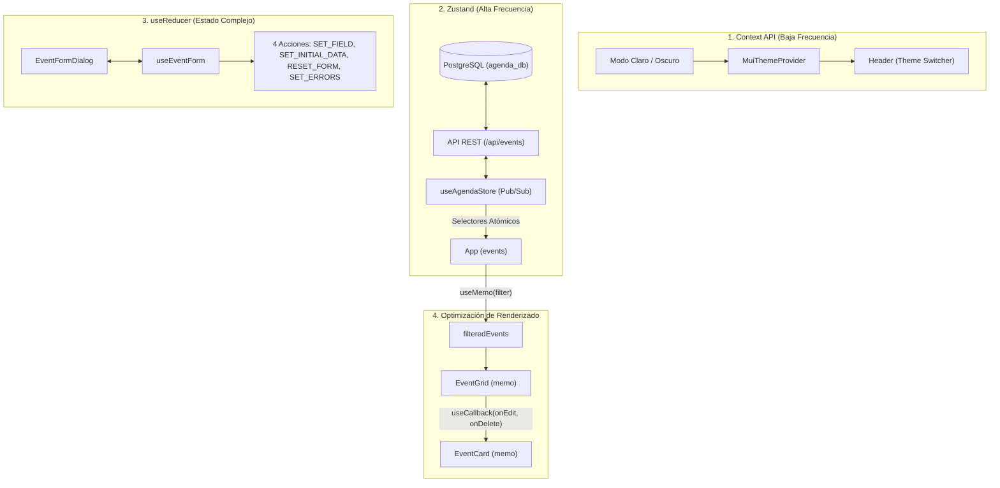

# 📅 Agenda de Eventos: Gestión de Estado Avanzado y Optimización de Rendimiento en React

Sistema web Full-Stack desarrollado con **React**, **TypeScript**, **Material-UI (MUI)**, **Zustand** y empaquetado con **Vite**, conectado mediante una API REST asíncrona en **Node.js / Express** con persistencia relacional en **PostgreSQL**, desplegado y ejecutado en un entorno virtualizado sobre **Fedora Linux**.

* **Repositorio Oficial:** [https://github.com/ErasmoHurtado/proy_agenda_tecno_2_2026](https://github.com/ErasmoHurtado/proy_agenda_tecno_2_2026)
* **Plataforma Objetivo:** Fedora Linux (sobre Oracle VM VirtualBox)

---

## 📖 1. Descripción y Objetivo del Proyecto

### ¿Qué es este proyecto?
Es una aplicación para la gestión de eventos y tareas (CRUD completo) que permite registrar, editar, listar, filtrar en tiempo real, marcar como completados y eliminar eventos con persistencia en base de datos.

### Objetivo Técnico
Demostrar de forma práctica la implementación de una arquitectura frontend escalable y de alto rendimiento en React mediante:
1. **Segmentación de Estado por Frecuencia:** Separación estricta entre estados globales de baja frecuencia (temas visuales), estados globales de alta frecuencia (datos del dominio CRUD) y estados locales complejos (formularios).
2. **Optimización del Virtual DOM:** Eliminación de re-renderizados innecesarios en cascada mediante la tríada de memoización (`React.memo`, `useCallback` y `useMemo`).
3. **Persistencia Relacional Concurrente:** Conexión backend eficiente mediante un Connection Pool (`pg.Pool`) con consultas SQL parametrizadas y control de zonas horarias.

---

## 🪟 2. Configuración Previa del Host (Windows para Oracle VM VirtualBox)

Antes de levantar la máquina virtual con Fedora Linux en Oracle VM VirtualBox, deben realizarse los siguientes ajustes en el sistema operativo Windows anfitrión:

### 2.1. Habilitar Virtualización por Hardware en BIOS/UEFI
* Acceder a la BIOS/UEFI de la placa base al encender el equipo.
* Verificar y habilitar la opción **Intel Virtualization Technology (Intel VT-x)** o **AMD-V / SVM Mode**.

### 2.2. Desactivar el Aislamiento del Núcleo (Integridad de Memoria)
En Windows 11 / Windows 10, la función de aislamiento del núcleo puede entrar en conflicto con el controlador del hipervisor de VirtualBox (`VBoxDrv`):
1. Abrir **Seguridad de Windows**.
2. Ir a **Seguridad del dispositivo** > **Detalles de aislamiento del núcleo**.
3. Desactivar la opción **Integridad de memoria**.
4. Reiniciar el equipo anfitrión.

### 2.3. Ajuste de Características de Windows
Si VirtualBox presenta lentitud o fallos al iniciar la máquina virtual de 64 bits:
1. Abrir *Activar o desactivar las características de Windows*.
2. Asegurar que **Hyper-V**, **Plataforma de hipervisor de Windows** y **Plataforma de máquina virtual** no bloqueen el acceso exclusivo de VirtualBox al hardware de virtualización.

### 2.4. Configuración de Red en VirtualBox
Para permitir que la máquina host pueda acceder a los servicios de la máquina virtual o comunicarse bidireccionalmente:
* En VirtualBox: seleccionar la máquina virtual Fedora > **Configuración** > **Red**.
* **Adaptador 1:** Configurar como **Adaptador Puente** (*Bridged Adapter*) para que la VM obtenga su propia IP en la red local, o bien utilizar **NAT** con reglas de reenvío de puertos (*Port Forwarding*):
  * Puerto Host: `5173` ➡️ Puerto Invitado: `5173` (Frontend)
  * Puerto Host: `3000` ➡️ Puerto Invitado: `3000` (Backend)

---

## 🐧 3. Instalación y Preparación del Entorno Base en Fedora Linux

Ejecutar los siguientes comandos en la terminal de Fedora Linux para preparar todas las dependencias del sistema:

### 3.1. Actualizar el Sistema
```bash
sudo dnf update -y
```

### 3.2. Instalar Node.js, npm y Git
```bash
sudo dnf install -y nodejs npm git
```
Verificar que la instalación fue exitosa:
```bash
node -v
npm -v
git --version
```

### 3.3. Instalar y Configurar PostgreSQL
1. **Instalar el servidor y utilidades:**
   ```bash
   sudo dnf install -y postgresql-server postgresql-contrib
   ```
2. **Inicializar la base de datos por primera vez en Fedora:**
   ```bash
   sudo postgresql-setup --initdb
   ```
3. **Habilitar e iniciar el servicio:**
   ```bash
   sudo systemctl enable --now postgresql
   ```
4. **Verificar que el servicio está activo:**
   ```bash
   sudo systemctl status postgresql
   ```

### 3.4. Configurar Autenticación en `pg_hba.conf`
Fedora configura por defecto el método `ident` para conexiones locales, lo que impide que Node.js se autentique mediante contraseña. Para permitir el acceso con usuario y contraseña (`md5`):

Ejecutar en la terminal de Fedora:
```bash
sudo sed -i 's/127.0.0.1\/32            ident/127.0.0.1\/32            md5/g' /var/lib/pgsql/data/pg_hba.conf
sudo sed -i 's/::1\/128                 ident/::1\/128                 md5/g' /var/lib/pgsql/data/pg_hba.conf
sudo systemctl restart postgresql
```

### 3.5. Configurar el Cortafuegos de Fedora (`firewalld`)
Abrir los puertos correspondientes para permitir la comunicación del servidor web y la API:
```bash
sudo firewall-cmd --add-port=5173/tcp --add-port=3000/tcp --permanent
sudo firewall-cmd --reload
```

---

## 🗄️ 4. Creación y Poblado de la Base de Datos (`agenda_db`)

La configuración de la base de datos se realiza directamente desde la consola interactiva `psql` de PostgreSQL en Fedora:

### 4.1. Acceder a la Consola Administrativa
```bash
sudo -u postgres psql
```

### 4.2. Ejecutar el Script de Inicialización y Semillas
Copiar y ejecutar los siguientes comandos SQL dentro de la consola:

```sql
-- 1. Establecer la contraseña del usuario postgres
ALTER USER postgres WITH PASSWORD '123456';

-- 2. Crear la base de datos si no existe
CREATE DATABASE agenda_db;

-- 3. Conectarse a la base de datos agenda_db
\c agenda_db

-- 4. Crear la tabla de eventos
DROP TABLE IF EXISTS events;

CREATE TABLE events (
    id SERIAL PRIMARY KEY,
    title VARCHAR(255) NOT NULL,
    description TEXT,
    event_date TIMESTAMP NOT NULL,
    priority VARCHAR(50) NOT NULL,
    is_completed BOOLEAN DEFAULT FALSE,
    created_at TIMESTAMP DEFAULT CURRENT_TIMESTAMP
);

-- 5. Crear índice para optimizar ordenaciones por fecha
CREATE INDEX IF NOT EXISTS idx_events_event_date ON events(event_date);

-- 6. Insertar registros iniciales de prueba (Seed Data)
INSERT INTO events (title, description, event_date, priority, is_completed) 
VALUES 
('Defensa del Tema 12', 'Exponer sobre gestión de estado avanzado y performance en React', '2026-11-20 10:00:00', 'Alta', false),
('Configurar el Backend Node', 'Asegurar conexión con PostgreSQL en Fedora VM', '2026-11-16 15:30:00', 'Media', true),
('Defensa en Fedora', 'Demostración en vivo conectando Vite con Express REST API', '2026-11-20 10:00:00', 'Alta', false);
```

### 4.3. Salir de la Consola
```sql
\q
```

---

## 🌐 5. Configuración del Proyecto y Variables de Entorno

### 5.1. Clonar el Repositorio
```bash
git clone https://github.com/ErasmoHurtado/proy_agenda_tecno_2_2026.git
cd proy_agenda_tecno_2_2026
```

### 5.2. Configurar Variables de Entorno del Backend
Crear el archivo `.env` dentro de `agenda-backend`:

```bash
cd agenda-backend

cat << 'EOF' > .env
PORT=3000
DB_USER=postgres
DB_HOST=localhost
DB_NAME=agenda_db
DB_PASSWORD=123456
DB_PORT=5432
CLIENT_ORIGIN=http://localhost:5173
EOF

cd ..
```

### 5.3. Configuración de Vite para Máquinas Virtuales (`vite.config.ts`)
Para que Vite permita el acceso desde fuera de la máquina virtual (a través de la IP de la VM en la red local), el archivo `agenda-frontend/vite.config.ts` incluye la directiva `host: true`:

```typescript
import { defineConfig } from 'vite';
import react from '@vitejs/plugin-react';

export default defineConfig({
  plugins: [react()],
  server: {
    port: 5173,
    host: true, // Escucha en 0.0.0.0 para ser accesible en la red de la VM
  },
});
```

---

## 🚀 6. Instalación y Ejecución del Sistema en Fedora Linux

Para ejecutar la aplicación, abrir **2 terminales** independientes en Fedora:

### 🖥️ Terminal 1: Backend (Node.js + Express)
```bash
cd ~/proy_agenda_tecno_2_2026/agenda-backend
npm install
npm run dev
```
* **Estado:** Servidor activo en `http://localhost:3000`
* **Test de Conexión a Base de Datos:** Abrir en el navegador:
  ```text
  http://localhost:3000/api/health
  ```
  Debe responder con estado `UP` y timestamp de PostgreSQL.

---

### 💻 Terminal 2: Frontend (React + Vite + MUI)
```bash
cd ~/proy_agenda_tecno_2_2026/agenda-frontend
npm install
npm run dev
```
* **Estado:** Aplicación disponible en `http://localhost:5173/`

---

## 🏛️ 7. Arquitectura de Estado y Optimización de Rendimiento

El frontend está estructurado en 4 pilares técnicos diseñados para resolver la sobrecarga de renderizado:



### 1. Context API (Estado Global de Baja Frecuencia)
* **Caso de uso:** Alternancia entre Modo Claro y Modo Oscuro con Material-UI.
* **Justificación:** Los cambios de tema ocurren de forma esporádica. El comportamiento intrínseco de Context API (forzar la actualización de sus consumidores) es idóneo para cambiar las paletas de color de toda la UI sin contaminar el estado de los datos.

### 2. Zustand (Estado Global de Alta Frecuencia)
* **Caso de uso:** Tienda global (`useAgendaStore`) para el CRUD de eventos conectado a PostgreSQL.
* **Justificación:** Opera como un almacén externo fuera del árbol de React mediante el patrón Publish/Subscribe. Mediante **suscripciones atómicas por selector** (`state => state.events`), un componente solo se re-renderiza cuando su segmento específico cambia, eliminando proveedores anidados (*Provider Hell*).

### 3. useReducer y Custom Hook (`useEventForm`)
* **Caso de uso:** Gestión del formulario modal de eventos (título, descripción, fecha, prioridad, estado completado).
* **Justificación:** Reemplaza múltiples `useState` por una función reductora pura `(state, action) => newState` estructurada en 4 órdenes:
  1. `'SET_FIELD'`: Actualiza un campo en tiempo real y limpia su error de validación.
  2. `'SET_INITIAL_DATA'`: Carga los datos de un evento preexistente al entrar en modo edición.
  3. `'RESET_FORM'`: Restablece el formulario a sus valores limpios iniciales.
  4. `'SET_ERRORS'`: Asigna mensajes de validación ante campos incompletos.
  * La función `dispatch` posee identidad referencial inmutable, evitando dependencias volátiles.

### 4. Optimización de Renderizado (`React.memo`, `useCallback`, `useMemo`)
* **`React.memo` (en `<EventCard />`, `<EventGrid />` y `<Header />`):** Compara superficialmente las *props* (`prevProps === nextProps`). Si las propiedades no cambian, React reutiliza el renderizado anterior.
* **`useCallback` (en `handleOpenEdit` y `handleDeleteEvent`):** Mantiene congelada la referencia en memoria de las funciones. Sin `useCallback`, cada ciclo del componente padre crearía nuevas funciones (`() => {} !== () => {}`), invalidando el `React.memo` de las tarjetas hijas.
* **`useMemo` (en `filteredEvents`):** Memoriza el resultado del filtrado de búsqueda. Si el usuario realiza acciones que no modifican la consulta ni la lista (ej. alternar el tema visual o abrir un diálogo), la lista no se vuelve a calcular en CPU.

---

## 📡 8. Endpoints de la API REST

Rutas montadas bajo el prefijo `/api/events`:

| Método | Endpoint | Descripción | Código HTTP |
|---|---|---|---|
| **GET** | `/api/health` | Verificación de salud y conectividad con PostgreSQL | `200 OK` |
| **GET** | `/api/events` | Listar todos los eventos ordenados cronológicamente | `200 OK` |
| **POST** | `/api/events` | Crear un nuevo evento | `201 Created` |
| **PUT** | `/api/events/:id` | Modificar datos de un evento o conmutar su estado `is_completed` | `200 OK` |
| **DELETE** | `/api/events/:id` | Eliminar físicamente un evento por su ID | `200 OK` |

---

## 📂 9. Estructura de Directorios

```text
proy_agenda_tecno_2_2026/
├── agenda-backend/                # Microservicio REST
│   ├── .env                       # Configuración local de base de datos y puertos
│   ├── .env.example               # Plantilla de variables de entorno
│   ├── db.js                      # Configuración de pg.Pool (Connection Pool)
│   ├── eventController.js         # Lógica SQL parametrizada
│   ├── eventRoutes.js             # Definición de rutas Express
│   ├── package.json               # Dependencias (express, pg, cors, dotenv)
│   ├── schema.sql                 # Script SQL de respaldo
│   └── server.js                  # Inicialización del servidor HTTP y CORS
│
├── agenda-frontend/               # Aplicación Cliente React
│   ├── src/
│   │   ├── types/
│   │   │   └── event.types.ts     # Tipado estático TypeScript
│   │   ├── context/
│   │   │   └── ThemeContext.tsx   # Context API para modo claro/oscuro
│   │   ├── store/
│   │   │   └── useAgendaStore.ts  # Tienda Zustand para CRUD de eventos
│   │   ├── hooks/
│   │   │   └── useEventForm.ts    # Custom Hook con useReducer para el modal
│   │   ├── components/
│   │   │   ├── Header.tsx         # Barra superior memoizada con switch de tema
│   │   │   ├── Toolbar.tsx        # Buscador y botón de nuevo evento
│   │   │   ├── EventCard.tsx      # Tarjeta memoizada con React.memo
│   │   │   ├── EventGrid.tsx      # Cuadrícula responsiva memoizada
│   │   │   └── EventFormDialog.tsx# Modal controlado por useEventForm
│   │   ├── App.tsx                # Orquestador con useMemo y useCallback
│   │   └── main.tsx               # Entrada con ThemeContextProvider
│   ├── package.json               # Dependencias (React 18, Vite 5, MUI, Zustand)
│   ├── tsconfig.json              # Configuración TypeScript estricta
│   └── vite.config.ts             # Configuración de Vite con host: true
│
├── .gitignore                     # Exclusión de node_modules y temporales
└── README.md                      # Documentación técnica completa
```
